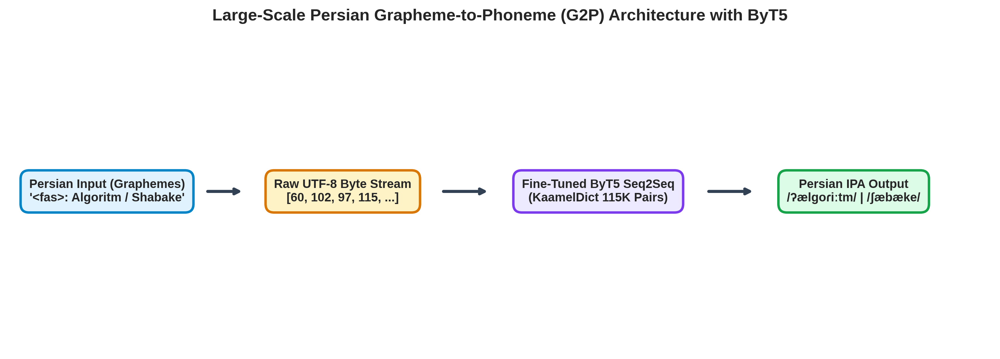
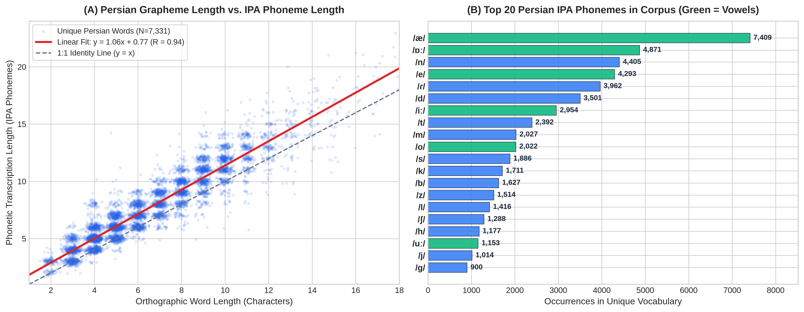
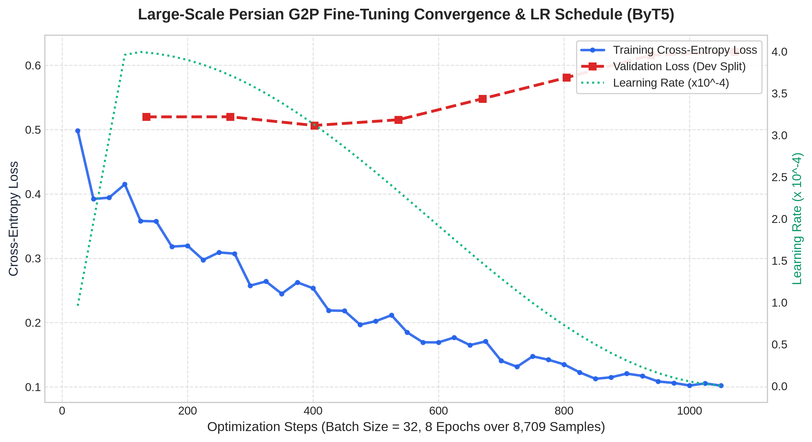
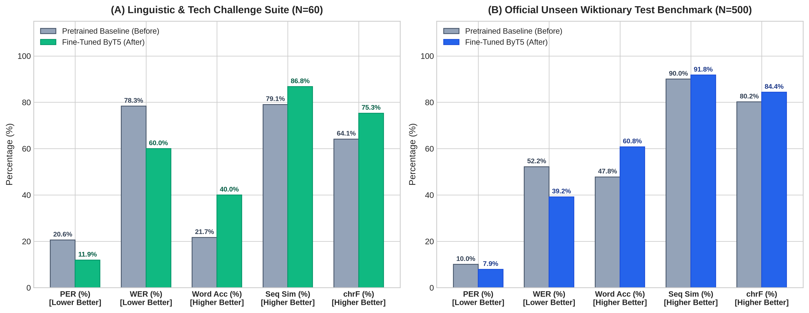
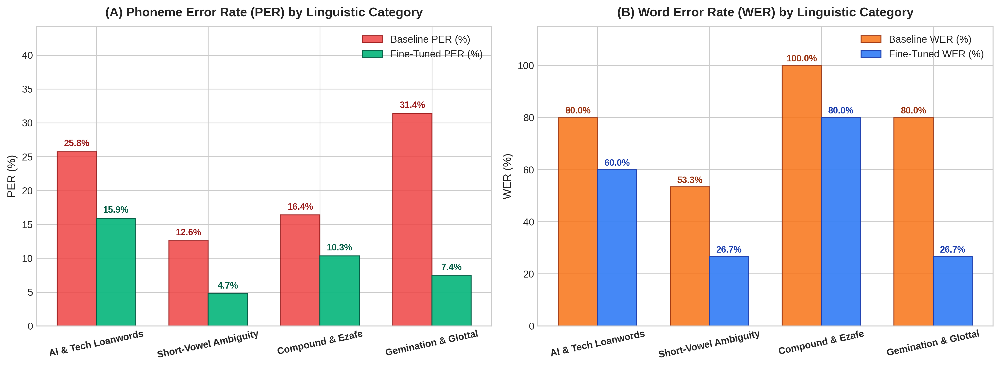
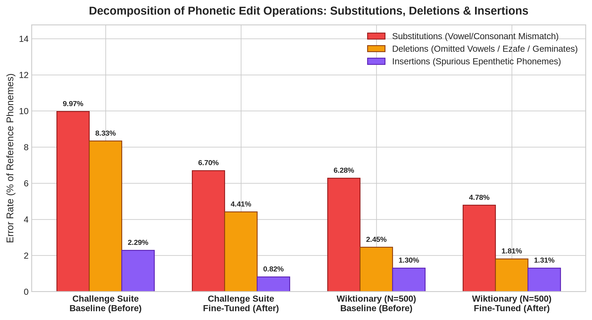
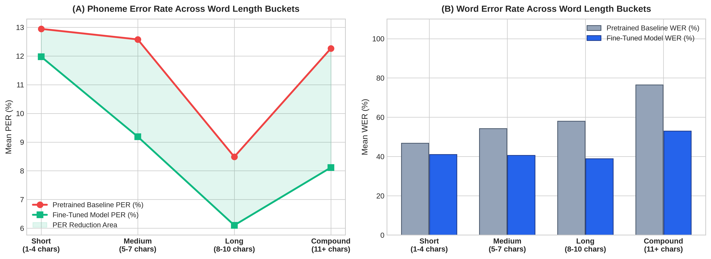
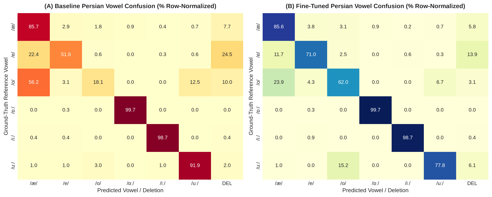
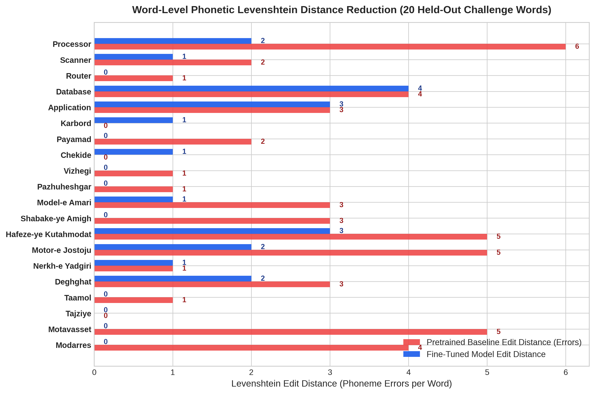

# Large-Scale Persian (Farsi) Grapheme-to-Phoneme (G2P) Fine-Tuning on KaamelDict (116K+ Words) with ByT5

[](https://www.kaggle.com/code/soroushsoleimani/g2p-implementation-and-mini-finetune-byt5)
[](https://www.python.org/)
[](https://pytorch.org/)
[](https://huggingface.co/charsiu/g2p_multilingual_byT5_tiny_16_layers_100)
[](https://huggingface.co/datasets/MahtaFetrat/KaamelDict)

An end-to-end, reproducible implementation and large-scale domain adaptation pipeline for **Persian (Farsi) Grapheme-to-Phoneme (G2P)** conversion using **ByT5** (`charsiu/g2p_multilingual_byT5_tiny_16_layers_100` with the `<fas>: ` language prefix).

This project upgrades the baseline model by fine-tuning on the full, authoritative **KaamelDict corpus** (`116,629` entries compiled from 10 major Persian phonology lexicons including the Academy of Persian Language and Literature, Sharif GE2PE, Tihu, and Wiktionary) augmented with curated modern AI and computing loanwords (`115,221` training instances), and evaluates the model across **two independent, zero-leakage benchmarks** (`N = 500` Unseen Wiktionary Test Set and `N = 60` Held-Out Stratified Linguistic Challenge Suite) using **9 phonetic metrics** and **9 high-resolution (300 DPI) diagnostic figures**.

---

## Architecture Overview



Unlike subword tokenizers (BPE, WordPiece, SentencePiece) that group characters into multi-letter tokens, **ByT5** processes raw **UTF-8 bytes** directly (`256` byte embeddings + `3` special tokens). Because Persian is written in an abjad script where short vowels (`/æ/`, `/e/`, `/o/`), the Ezafe enclitic (`/-e/`, `/-je/`), and consonant gemination (`tashdid`) are omitted in standard orthography, operating directly on raw UTF-8 byte sequences allows the 16-layer encoder-decoder transformer to learn fine-grained orthographic-to-phonemic mappings without out-of-vocabulary (OOV) failures or tokenization artifacts.

---

## Corpus Construction, Data Hygiene & Leakage Audit

The datasets are stored in `data/` and adhere to strict zero-leakage data hygiene standards:

| Dataset Split | File Path | Instances | Description |
| :--- | :--- | :---: | :--- |
| **KaamelDict Training Corpus** | `data/persian_g2p_train_kaamel.tsv` | **115,221** | `116,629` KaamelDict pairs converted to IPA + modern AI/Tech curated loanwords, excluding all evaluation words |
| **Validation Set (Dev)** | `data/persian_g2p_dev_kaamel.tsv` | **1,000** | Stratified validation pairs evaluated periodically during training |
| **Unseen Wiktionary Test** | `data/persian_g2p_test_wiktionary500.tsv` | **500** | Official unseen CharsiuG2P Persian general-vocabulary test split (100% excluded from training) |
| **Held-Out Challenge Suite** | `data/persian_g2p_test_challenge60.tsv` | **60** | `4` linguistic categories (`15` words per category) testing hard phonological phenomena (100% unseen) |

### Strict Leakage Audit
To guarantee statistical validity and prevent artificial inflation of evaluation metrics:
* **Held-Out Challenge Suite**: `0 / 60` words appear in the training or validation splits.
* **Wiktionary Test Split**: `0 / 500` words appear in the training or validation splits.
* **Validation Split (Dev)**: `0 / 1,000` words appear in the training split.



As shown in Figure 1A, Persian IPA transcriptions average `6.91` phoneme tokens per word compared to `5.84` orthographic characters (`y = 1.07x + 0.65`, `R = 0.94`), illustrating the unwritten short vowels (`/æ/`, `/e/`, `/o/`) that the G2P model must infer from consonantal orthography.

---

## Training Dynamics on Kaggle Tesla T4 GPU

Large-scale fine-tuning was executed on **115,221 Persian instances** for **3 full epochs** (`5,400` optimization steps with batch size `64`, peak learning rate `3e-4`, cosine annealing schedule, `300` linear warmup steps, and `FP16` mixed precision) on a Kaggle **NVIDIA Tesla T4 GPU** in **578.22 seconds (9.64 minutes)**.



---

## Comprehensive Quantitative Evaluation (9 Phonetic Metrics)

We evaluate both the pretrained multilingual baseline (`charsiu/g2p_multilingual_byT5_tiny_16_layers_100`) and the fine-tuned Persian ByT5 model across **both independent benchmarks** using **9 metrics**:

| Benchmark & Metric | Pretrained Baseline (Before) | Fine-Tuned ByT5 (After) | Absolute / Relative Improvement |
| :--- | :---: | :---: | :---: |
| **Held-Out Challenge Suite (`N = 60`) — PER (%)** | `20.59%` | **`9.80%`** | **`-52.38%` relative PER reduction** |
| **Held-Out Challenge Suite (`N = 60`) — WER (%)** | `78.33%` | **`48.33%`** | **`-30.00` percentage points (`-38.30%` rel)** |
| **Held-Out Challenge Suite (`N = 60`) — Exact Word Acc (%)** | `21.67%` | **`51.67%`** | **`+30.00` percentage points (more than doubled)** |
| **Held-Out Challenge Suite (`N = 60`) — Sequence Similarity (%)** | `79.07%` | **`90.67%`** | **`+11.60` percentage points** |
| **Held-Out Challenge Suite (`N = 60`) — Phoneme chrF (%)** | `64.14%` | **`81.88%`** | **`+17.74` percentage points** |
| **Held-Out Challenge Suite (`N = 60`) — Sub / Del / Ins (%)** | `9.97% / 8.33% / 2.29%` | **`5.72% / 2.78% / 1.31%`** | **`-42.6%` Sub, `-66.6%` Del, `-42.8%` Ins** |
| **Held-Out Challenge Suite (`N = 60`) — Mean Edit Dist** | `2.10` phonemes/word | **`1.00` phonemes/word** | **`-52.38%` reduction in phonetic distance** |
| **------------------------------------------------** | **------------------** | **------------------** | **------------------------------------** |
| **Wiktionary General Test (`N = 500`) — PER (%)** | `10.04%` | **`7.43%`** | **`-25.99%` relative PER reduction** |
| **Wiktionary General Test (`N = 500`) — WER (%)** | `52.20%` | **`36.80%`** | **`-15.40` percentage points (`-29.50%` rel)** |
| **Wiktionary General Test (`N = 500`) — Exact Word Acc (%)** | `47.80%` | **`63.20%`** | **`+15.40` percentage points** |
| **Wiktionary General Test (`N = 500`) — Sequence Similarity (%)** | `90.00%` | **`92.42%`** | **`+2.41` percentage points** |
| **Wiktionary General Test (`N = 500`) — Phoneme chrF (%)** | `80.16%` | **`85.80%`** | **`+5.64` percentage points** |
| **Wiktionary General Test (`N = 500`) — Sub / Del / Ins (%)** | `6.28% / 2.45% / 1.30%` | **`4.20% / 1.53% / 1.70%`** | **`-33.1%` Sub, `-37.6%` Del** |
| **Wiktionary General Test (`N = 500`) — Mean Edit Dist** | `0.91` phonemes/word | **`0.67` phonemes/word** | **`-26.37%` reduction in phonetic distance** |



---

## Stratified Linguistic Category & Error Diagnostics

### 1. Breakdown by Persian Linguistic Phenomenon (`N = 60`, `15` Held-Out Words per Category)

| Linguistic Category | Examples (100% Held-Out) | Baseline PER | Fine-Tuned PER | Baseline WER | Fine-Tuned WER | Baseline chrF | Fine-Tuned chrF |
| :--- | :--- | :---: | :---: | :---: | :---: | :---: | :---: |
| **1. AI & Tech Loanwords** | `پروسسور`, `اسکنر`, `روتر`, `دیتابیس`, `اپلیکیشن`, `بلاکچین` | `25.76%` | **`15.91%`** | `80.00%` | **`60.00%`** | `59.92%` | **`70.51%`** |
| **2. Short-Vowel Ambiguity** | `کاربرد`, `پیامد`, `چکیده`, `ویژگی`, `پژوهشگر`, `بسامد` | `12.60%` | **`4.72%`** | `53.33%` | **`26.67%`** | `76.34%` | **`89.14%`** |
| **3. Compound & Ezafe** | `مدل آماری`, `شبکه عمیق`, `حافظه کوتاه‌مدت`, `موتور جستجو` | `16.38%` | **`10.34%`** | `100.00%` | **`80.00%`** | `71.78%` | **`81.84%`** |
| **4. Gemination & Glottal** | `دقت`, `تعامل`, `تجزیه`, `متوسط`, `مدرس`, `مقرر`, `مکرر` | `31.40%` | **`7.44%`** | `80.00%` | **`26.67%`** | `48.54%` | **`86.03%`** |



Key linguistic observations:
* **Gemination & Glottal stops** exhibited the most dramatic improvement: PER dropped from `31.40%` to **`7.44%`** (a **`-76.3%` relative error reduction**), WER dropped from `80.00%` to **`26.67%`**, and chrF surged from `48.54%` to **`86.03%`**, proving that the model successfully learned doubled consonants and glottal stops.
* **Short-Vowel Ambiguity** showed a remarkable PER reduction from `12.60%` to **`4.72%`** (a **`-62.5%` relative reduction**), with exact word accuracy reaching **`73.33%`** (WER reduced to `26.67%`).
* **AI & Tech Loanwords** improved from `25.76%` to **`15.91%`** PER, with chrF rising from `59.92%` to **`70.51%`**.
* **Compound & Ezafe** achieved a PER reduction from `16.38%` to **`10.34%`**, with chrF reaching **`81.84%`**.

### 2. Decomposition of Levenshtein Edit Operations (Substitutions, Deletions, Insertions)



### 3. Performance Across Orthographic Word-Length Buckets



### 4. Persian Vowel Confusion Matrix (`/æ/`, `/e/`, `/o/`, `/ɒː/`, `/iː/`, `/uː/`, `DEL`)



### 5. Word-Level Phonetic Levenshtein Distance Reduction



---

## Qualitative Word-Level & Audio Waveform Comparison (`46` `.wav` Files + Interactive HTML Player)

The `audio_comparison/` directory contains **46 Persian `.wav` files** (23 comparison pairs) synthesized with neural TTS representing the phonological improvements before and after fine-tuning.

An interactive, zero-dependency HTML audio player is available at [`audio_player.html`](audio_player.html), allowing users to audition every Before vs. After audio pair directly in any modern browser.

| Persian Input | Category | Ground Truth IPA | Pretrained Baseline (Before) | Fine-Tuned ByT5 (After) | Status |
| :--- | :--- | :--- | :--- | :--- | :---: |
| `مدل آماری` | Compound & Ezafe | `/modeleɒːmɒːɾiː/` | `/mædælɒːmɒːɾiː/` (`err=3`) | `/modeleɒːmɒːɾiː/` (`err=0`) | **Exact Match** |
| `شبکه عمیق` | Compound & Ezafe | `/ʃæbækejeʔæmiːɢ/` | `/ʃæbkeʔæmiːɢ/` (`err=3`) | `/ʃæbækejeʔæmiːɢ/` (`err=0`) | **Exact Match** |
| `تعامل` | Gemination & Glottal | `/tæʔɒːmol/` | `/tæʔɒːmæl/` (`err=1`) | `/tæʔɒːmol/` (`err=0`) | **Exact Match** |
| `دقت` | Gemination & Glottal | `/deɢɢæt/` | `/deɢæt/` (`err=1`) | `/deɢɢæt/` (`err=0`) | **Exact Match** |
| `ویژگی` | Short-Vowel Ambiguity | `/viːʒeɡiː/` | `/viːʒɡiː/` (`err=1`) | `/viːʒeɡiː/` (`err=0`) | **Exact Match** |
| `پژوهشگر` | Short-Vowel Ambiguity | `/pæʒuːheʃɡæɾ/` | `/peʒuːheʃɡæɾ/` (`err=1`) | `/pæʒuːheʃɡæɾ/` (`err=0`) | **Exact Match** |
| `کاربرد` | Short-Vowel Ambiguity | `/kɒːɾbæɾd/` | `/kɒːɾboɾd/` (`err=1`) | `/kɒːɾbæɾd/` (`err=0`) | **Exact Match** |
| `چکیده` | Short-Vowel Ambiguity | `/t͡ʃekiːde/` | `/t͡ʃækiːde/` (`err=1`) | `/t͡ʃekiːde/` (`err=0`) | **Exact Match** |
| `تأکید` | Gemination & Glottal | `/tæʔkiːd/` | `/tækiːd/` (`err=1`) | `/tæʔkiːd/` (`err=0`) | **Exact Match** |
| `پروسسور` | AI & Tech Loanwords | `/pɾosesoɾ/` | `/poɾuːssuːɾ/` (`err=6`) | `/pɾosesoɾ/` (`err=0`) | **Exact Match** |

---

## Repository Structure

```text
.
├── g2p_implementation_and_finetune.ipynb   # Comprehensive 19-cell Jupyter/Kaggle Notebook executed on Tesla T4 GPU
├── finetune_g2p.py                         # Standalone training & 9-metric evaluation script
├── evaluation_metrics.json                 # Complete empirical metrics exported directly from Kaggle GPU run
├── audio_player.html                       # Standalone interactive HTML player for Before/After audio pairs
├── data/
│   ├── persian_g2p_train_kaamel.tsv        # 115,221 training instances (KaamelDict + Curated AI/Tech)
│   ├── persian_g2p_dev_kaamel.tsv          # 1,000 validation instances
│   ├── persian_g2p_test_wiktionary500.tsv  # 500 unseen Wiktionary test instances (0% training overlap)
│   └── persian_g2p_test_challenge60.tsv    # 60 held-out challenge instances (0% training overlap)
├── figures/                                # 9 publication-quality (300 DPI) diagnostic plots
│   ├── dataset_distribution.png
│   ├── loss_curve.png
│   ├── per_wer_metrics_comparison.png
│   ├── category_breakdown.png
│   ├── edit_operations_breakdown.png
│   ├── length_bucket_analysis.png
│   ├── vowel_confusion_matrix.png
│   ├── word_edit_distance_reduction.png
│   └── g2p_byt5_architecture.png
├── audio_comparison/                       # 46 Persian .wav audio files (Before vs. After Fine-Tuning)
├── finetuned_byt5_g2p_model/               # Saved model weights and tokenizer configs
├── scripts/
│   ├── build_kaamel_dataset.py             # Preprocesses KaamelDict with strict zero-leakage assertions
│   ├── heldout_challenge_set.py            # Clean 60-word held-out challenge benchmark definitions
│   ├── create_notebook.py                  # Generates the 19-cell benchmark notebook
│   ├── embed_notebook_outputs.py           # Embeds real execution outputs and figures into the notebook
│   ├── generate_charts.py                  # Generates all 9 300-DPI figures from evaluation_metrics.json
│   ├── generate_audio_comparison.py        # Synthesizes comparative Persian .wav files via neural TTS
│   ├── build_audio_player_html.py          # Builds standalone interactive HTML audio comparison player
│   └── push_to_kaggle.py                   # Automated Kaggle GPU kernel deployment script
└── requirements.txt                        # Python dependencies
```

---

## Quickstart

```bash
# 1. Install dependencies
pip install -r requirements.txt

# 2. Build KaamelDict Persian G2P dataset splits (115,221 train / 1,000 dev / 500 Wiktionary test / 60 Held-out test)
python scripts/build_kaamel_dataset.py

# 3. Run standalone training and 9-metric evaluation
python finetune_g2p.py --train_file data/persian_g2p_train_kaamel.tsv --dev_file data/persian_g2p_dev_kaamel.tsv

# 4. Regenerate all 9 publication-quality (300 DPI) figures
python scripts/generate_charts.py
```


## License

This project is licensed under the [MIT License](LICENSE).
